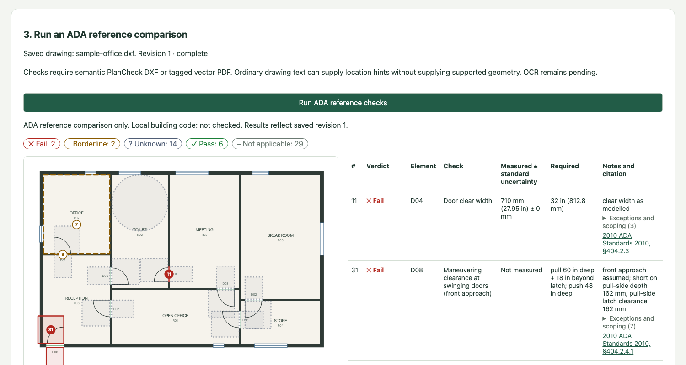

# PlanCheck

PlanCheck turns a floor plan into a structured, editable building model (walls, doors, windows, rooms), exports it to DXF, IFC, and glTF, and checks it against the 2010 ADA Standards and the building code adopted by the project's own jurisdiction. The scope for now is India and the USA. Each finding is drawn on the plan with the measured value, the required value, and the cited section.

> **This is a design-assist tool, not a code review.** It checks a small number of provisions, and it cannot see anything that is not drawn on a floor plan. A report with no findings does not mean a design complies. The code that applies depends on the jurisdiction, the edition it adopted, and the project's permit date. Verify every result against the adopted code.



*A synthetic seven-room sample (`make demo`), checked against the 2010 ADA Standards. The narrow toilet-room door and the entrance fail; the office door is within its measurement uncertainty of the minimum, so it is reported as borderline, not as a pass.*

## Status

Early development. The project is built in milestones; progress, engineering rules and open decisions are in [docs/IMPROVEMENT_PLAN.md](docs/IMPROVEMENT_PLAN.md), and the full specification is in [docs/PROJECT_SPEC.md](docs/PROJECT_SPEC.md). Results tables will be added here from the generated evaluation report.

## Setup

Requires Python 3.11 or later and [uv](https://docs.astral.sh/uv/).

```
make setup
make lint
make test
```

## Exact-input engineering demo

```sh
make demo
make eval
make budget
```

Open `out/demo/sample-office/dxf/report.html` for a seven-room sample with its findings
drawn on the plan. The generated folders include saved runs,
readable reports, the plan drawing, IFC, BCF, DXF and GLB from both exact input paths.
This uses three one-room synthetic fixtures pending independent author review, plus the
synthetic sample, which has no expected verdicts. The importer supports an
explicit semantic DXF/tagged-PDF convention; ordinary untagged drawings and raster
extraction remain future work. See [supported inputs and acceptance gaps](docs/exact-input-demo.md).

Ordinary PDF/DXF location text can now be extracted independently of geometry import,
with unconfirmed candidates and source-page/position evidence. See
[location evidence extraction](docs/location-evidence.md) for the command and supported labels.

## Local web page

```sh
make web
```

Open http://127.0.0.1:8000 for local drawing-location review, manual authority selection, confirmation and saved project drafts. Supported semantic DXF/tagged PDF drawings can run an explicitly selected ADA reference comparison, which shows the plan beside the findings table and offers the reports and model exports as downloads. To try it, upload `out/demo/sample-office/source.dxf`. With `OPENROUTER_API_KEY` set in `.env`, an "Explain findings" button adds a plain-language explanation to each finding that needs attention; the model writes the words and PlanCheck fills in every number and citation. OCR and local-code execution remain pending. See [location evidence](docs/location-evidence.md#local-confirmation-webpage).

## How it decides

Every pass or fail comes from a deterministic geometry check on the building model. Each measurement carries an uncertainty, and a result is only called a pass or a fail when the measurement clears the requirement by more than that uncertainty. A language model explains results and cites code text; it never decides them.

## Licences and data

- The segmentation model is trained on [CubiCasa5K](https://zenodo.org/records/2613548) (Kalervo et al., 2019), licensed CC BY-NC-SA 4.0. The trained weights and anything else derived from the dataset are released under the same licence, for non-commercial use only. See [data sources](docs/data_sources.md).
- The International Building Code is copyrighted. This repository stores section numbers, short paraphrases, and numeric requirements, and links to the publisher for the text.
- Dependency licences are listed in [docs/dependencies.md](docs/dependencies.md).
